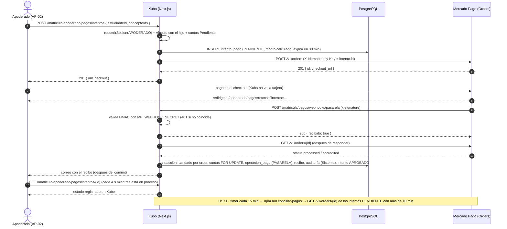

# Arquitectura · Pago en línea con Mercado Pago (US70, US71)

Decisión AD-15, Figura 11 (flujo del pago en línea) y escenario de calidad AC10. Sprint 3, bloque 1. Código en `src/modules/matricula` (la tesorería vive en el módulo `matricula`, dueño de `operacion_pago` e `intento_pago`).

## AD-15 · Pasarela de pagos: Mercado Pago Checkout Pro con la API de Orders, detrás del puerto `PasarelaPagos`

**Contexto.** Hasta el sprint 2 el pago solo lo registraba tesorería a mano (US22). US70 agrega el pago en línea desde el portal del apoderado y US71, la conciliación y la devolución. La cuenta de Mercado Pago del colegio se creó con la **API de Orders** (Checkout Pro), porque la API de Preferences será descontinuada. Solo se usa el **modo de prueba** (sandbox, sin dinero real).

**Decisión.**

1. El módulo `matricula` define el puerto `PasarelaPagos` (`domain/pasarela.ts`) con dos operaciones: `crearCobro` y `consultarPago`. Tiene dos adaptadores en `infrastructure/pasarela/`:
   - `mercadoPago.ts`: Checkout Pro con Orders, con el **SDK oficial `mercadopago` 3.6.1** (clientes `Order.create` y `Order.get`). El SDK soporta Orders y no tiene dependencias. Se fijó la 3.6.1 (septiembre de 2026) porque la 3.6.2 se publicó el mismo día del cambio.
   - `falsa.ts`: imita una order en memoria (mismos estados que Orders) y su «checkout» es una pantalla de Kubo. Se usa en desarrollo y en las pruebas. No se acepta con `NODE_ENV=production`.
2. La configuración (`PASARELA` = `mercadopago` | `falsa`, `MP_ACCESS_TOKEN`, `MP_WEBHOOK_SECRET`) se valida con Zod en cada uso (`infrastructure/pasarela/config.ts`). Si falta o es inválida, el pago en línea queda apagado: el botón «Pagar» no aparece y el resto del sistema funciona igual. El log solo indica los nombres de las variables con problemas, nunca sus valores.
3. Un pago **solo se registra con lo que responde la pasarela servidor a servidor** (aviso firmado o conciliación). La URL de retorno nunca confirma nada.
4. El registro reutiliza el núcleo del pago manual de US22 (`registrarOperacion` en `application/pagos.ts`). Ese núcleo bloquea las cuotas, exige el monto exacto, emite el recibo de US25, envía el correo y registra la auditoría de US04. El actor es el **Sistema** (`usuario_id` nulo) y el origen, `PASARELA`.
5. Idempotencia: `operacion_pago.referencia_externa` guarda el id de la order con índice único (`uq_operacion_pago_referencia_externa`). Además, un candado `pg_advisory_xact_lock` por order serializa los avisos simultáneos.
6. Las cuotas **no se reservan** al crear el intento. Se validan al confirmar: si una ya está pagada, la operación queda **Observado** con el motivo «Cuota pagada por otro medio» y no toca las cuotas. Tesorería luego la confirma o registra la devolución (US71).

**Alternativas descartadas.**
- *API de Preferences* (`init_point`): será descontinuada y la cuenta ya está creada con Orders.
- *Llamar a la API REST con `fetch`*: era viable, pero el SDK oficial soporta Orders y trae el validador de firma `WebhookSignatureValidator`. Así no se mantiene una implementación propia del HMAC.
- *Reservar las cuotas al crear el intento*: bloquearía el pago manual durante 30 minutos aunque el apoderado abandone el checkout. Se prefirió validar al confirmar y observar el conflicto.
- *Procesar el aviso antes de responder*: Mercado Pago reintenta si no recibe 200/201 en 22 s. Se responde de inmediato y la consulta de la order se hace con `after()` de Next.js. Si falla, la conciliación la recupera.

**Consecuencias.**
- `operacion_pago.registrado_por_id` pasa a admitir nulo, solo con `origen = 'PASARELA'` (`ck_operacion_pago_registrador`).
- La devolución del dinero se hace en el panel de Mercado Pago. Kubo solo la registra (`REGISTRAR_DEVOLUCION`).
- Se agrega `tsx` (devDependency) para el comando `npm run conciliar-pagos`, que corre fuera de Next.js.

### Endpoints de Mercado Pago que usa Kubo

| Uso en Kubo | Llamada | Detalle |
|---|---|---|
| Crear el cobro (`crearCobro`) | `POST https://api.mercadopago.com/v1/orders` | Cabeceras `Authorization: Bearer <MP_ACCESS_TOKEN>` y `X-Idempotency-Key: <id del IntentoPago>` (las pone el SDK). Cuerpo: `type: "online"`, `processing_mode: "manual"`, `total_amount` (texto, igual a la suma de los ítems), `external_reference` (código `KUBO-…` del intento, menos de 64 caracteres), `description`, `expiration_time: "PT30M"`, `items[]` con `title`, `unit_price` (texto) y `quantity: 1`, y `config.online` con `success_url`, `failure_url`, `pending_url` (la pantalla de retorno) y `auto_return: "approved"`. Respuesta 201 con `id` y `checkout_url`, a donde se redirige al apoderado. |
| Consultar el pago (`consultarPago`) | `GET https://api.mercadopago.com/v1/orders/{id}` | Se leen `status`, `status_detail`, `total_amount`, `total_paid_amount` y `external_reference`. Un 404 (`order_not_found`) se trata como order desconocida. Lo usan el webhook, la pantalla de retorno y la conciliación (US71). |
| Aviso (webhook) | `POST {APP_URL}/api/v1/matricula/pagos/webhooks/pasarela?data.id=<order>&type=order` | Evento «Order (Mercado Pago)», configurado en *Tus integraciones → Webhooks*. Cuerpo con `action` (por ejemplo, `order.processed`), `type: "order"` y `data.id`. |

**Firma `x-signature`.** La cabecera tiene la forma `ts=<timestamp>,v1=<hex>`. Kubo arma el manifiesto `id:<data.id de la query>;request-id:<cabecera x-request-id>;ts:<ts>;` (omitiendo las partes ausentes), calcula HMAC-SHA256 con `MP_WEBHOOK_SECRET` y lo compara en tiempo constante con `v1`. Lo hace `WebhookSignatureValidator.validate` del SDK oficial. Si no coincide, responde **401** `FIRMA_INVALIDA` y no consulta nada. Si coincide, responde **200** `{ recibido: true }` y consulta la order después.

### Estados de una order y cómo los interpreta Kubo

| `status` / `status_detail` de la order | Resultado en el puerto | Efecto en el intento |
|---|---|---|
| `processed` / `accredited`, con `total_paid_amount` = `total_amount` = monto del intento y `external_reference` = código del intento | `PAGADO` | Se registra la operación: **Aprobado** (o **Observado** si una cuota ya estaba pagada) |
| `processed` / `accredited`, pero con otro monto o referencia | `PAGADO` | No se registra: intento **Observado** («El monto pagado no coincide con las cuotas») y aviso en el log |
| `failed` / (`rejected_by_issuer`, `insufficient_amount`, `high_risk`…) | `RECHAZADO` | **Rechazado** |
| `canceled` o `expired` | `EXPIRADO` | **Expirado** |
| `created` / `created` (sin pago) | `SIN_PAGO` | Sigue **Pendiente**; pasado `expira_en`, **Expirado** |
| `processing` (`in_process`, `pending_review_manual`) o `action_required` | `EN_PROCESO` | Sigue **Pendiente** («En proceso» en la pantalla) |
| `refunded`, `charged_back` o `processed` / `partially_refunded` | `DEVUELTO` | Si aún no se registró, **Rechazado** |

Un aviso nunca retrocede un intento resuelto: Aprobado y Observado son finales. Un Rechazado o Expirado solo cambia si después llega un pago acreditado (el apoderado reintentó con otra tarjeta en la misma order).

### Fuentes consultadas (11/11/2026)

- Checkout Pro con Orders, crear y configurar la order: https://www.mercadopago.com.pe/developers/es/docs/checkout-pro-orders/create-order (el contenido es el mismo que en la versión .com.br).
- Referencia `POST /v1/orders` de Checkout Pro: https://www.mercadopago.com.br/developers/en/reference/online-payments/checkout-pro/create-order/post. La versión de Perú respondió 404 ese día.
- Referencia `GET /v1/orders/{id}`: https://www.mercadopago.com.ar/developers/es/reference/online-payments/checkout-pro/get-order/get. La versión de Perú respondió 404 ese día.
- Estados de la order: https://www.mercadopago.com.pe/developers/es/docs/checkout-pro-orders/payment-management/status/order-status.
- Notificaciones (evento «Order (Mercado Pago)»): https://www.mercadopago.com.pe/developers/es/docs/checkout-pro-orders/notifications.
- SDK oficial: https://github.com/mercadopago/sdk-nodejs (`Order`, `WebhookSignatureValidator`).

**Pendiente de confirmar con las credenciales de prueba:** el juego de caracteres permitido en `external_reference` (la página lo trunca) y si el sandbox acepta `http://localhost` en las URL de retorno. En local se usa la pasarela falsa.

## Figura 11 · Flujo del pago en línea

## AC10 · Escenario de calidad: un pago en línea se registra una sola vez y solo si la pasarela lo confirma

| Parte | Descripción |
|---|---|
| **Fuente** | Mercado Pago (avisos y reintentos), un tercero que imita el webhook, o el apoderado que vuelve del checkout |
| **Estímulo** | Avisos duplicados o simultáneos de la misma order, un aviso con firma falsa, una URL de retorno manipulada, o un pago manual en tesorería de la misma cuota al mismo tiempo |
| **Artefacto** | `POST /api/v1/matricula/pagos/webhooks/pasarela`, `registrarOperacion` y las tablas `operacion_pago` e `intento_pago` |
| **Entorno** | Operación normal, con Mercado Pago en modo de prueba. El aviso puede perderse si la EC2 está apagada (Learner Lab) |
| **Respuesta** | La firma inválida se rechaza con 401. La order se consulta servidor a servidor. Un aviso repetido no crea otra operación. Si la cuota ya se pagó, la operación queda Observado y no se cobra dos veces la cuota. Un aviso perdido lo recupera la conciliación |
| **Medida** | 0 operaciones duplicadas por order (índice único y candado). 0 pagos registrados solo por la URL de retorno. Respuesta al aviso en menos de 22 s. Un intento pendiente se resuelve en 25 min como máximo (10 min de espera más el timer de 15 min). Lo verifican las pruebas de `tests/matricula/pasarela.integracion.test.ts` en el CI |
